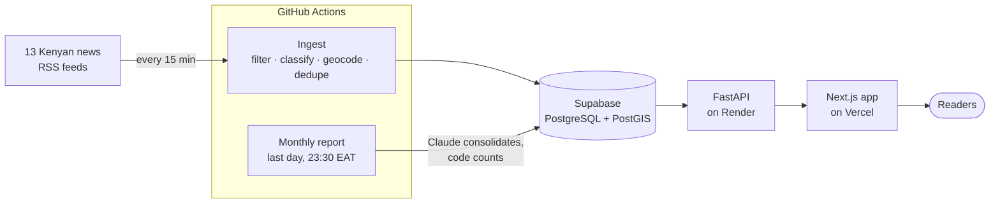

<div align="center">

# Deckwatch Kenya

**Public safety intelligence for Kenya. What happened, where it happened, and how sure we are.**

[](https://github.com/lawmaluki/deckwatch/actions/workflows/ci.yml)
[](https://github.com/lawmaluki/deckwatch/actions/workflows/ingest.yml)


[Live site](https://deckwatch.vercel.app) · [Monthly report](https://deckwatch.vercel.app/dashboard/reports) · [API docs](https://deckwatch.vercel.app/api-docs) · [Why Deckwatch](https://deckwatch.vercel.app/why)

</div>

---


Kenyans deciding whether it is safe to travel, commute or attend an event mostly rely on scattered news alerts, group chats and word of mouth. Deckwatch replaces that guesswork with one map-first view of what is happening and where, built from 13 Kenyan newsrooms, scored for how well each report is corroborated, and summed up in a monthly safety report.

## Features

- **Live incident map.** Every incident on a map of Kenya's 47 counties, with marker clustering, a heat map, and a timeline to replay how a day or week unfolded.
- **News ingestion every 15 minutes.** RSS feeds from 13 Kenyan outlets are filtered, classified into 11 incident categories, placed in a county, and merged with earlier coverage of the same event.
- **Verification scoring.** Each incident carries a status (verified, likely true, unconfirmed) based on how many independent outlets reported it, with links to every source.
- **National and county dashboards.** A 24-hour picture, 14-day trends, category mix, and a risk score for each county. Every figure links through to the incidents behind it.
- **Monthly safety report.** Published on the last day of each month. The month's coverage is consolidated into distinct incidents, so the same crash reported 20 times counts once, and the report covers hotspots, county briefs, what changed, and what remains uncertain.
- **Alerts.** Subscribe to counties, categories or a distance around you and get notified in the app, and on your desktop if you allow it.
- **Intel Feed.** A running list of the latest incidents, opened beside the map.
- **Public API.** JSON endpoints for incidents, counties and monthly reports, documented at [`/api-docs`](https://deckwatch.vercel.app/api-docs).

## How it works



1. **Ingest** (`backend/app/ingest`). A scheduled job fetches each feed, keeps items that look like safety incidents, classifies them (rule-based by default, or Claude Haiku 4.5), resolves a county and coordinates, and either inserts a new incident or folds the article into a matching one as a corroborating source.
2. **Serve** (`backend/app`). A FastAPI service reads incidents from PostGIS and serves them as JSON. The Next.js app calls it server-side through its own `/api/*` routes, so the backend URL is never exposed to the browser.
3. **Report** (`backend/app/monthly`). On the last day of the month, Claude Opus 5.5 groups the month's articles into distinct incidents, corrects counties, sets aside context and off-topic items, and writes the editorial notes. Python code then computes every published figure from the articles themselves, so the model can shape the grouping but cannot invent a number.

## Tech stack

| Layer | Technology |
|---|---|
| Frontend | Next.js 16 (App Router), React 19, TypeScript, Tailwind CSS 4 |
| Maps & charts | Leaflet, react-leaflet, Supercluster, leaflet.heat, Recharts |
| State | Zustand |
| Backend | FastAPI, SQLAlchemy, GeoAlchemy2, psycopg 3 |
| Database | PostgreSQL with PostGIS (Supabase in production) |
| AI | Anthropic Claude: Haiku 4.5 for optional classification, Opus 5.5 for monthly reports |
| Hosting | Vercel (frontend), Render (API), GitHub Actions (scheduled jobs) |
| Testing | Vitest, pytest, ESLint, TypeScript |

## Getting started

### Frontend only (no backend needed)

Requires Node.js 22.

```bash
npm install
npm run dev
```

Open http://localhost:3000. With no configuration the app runs on a built-in sample dataset, so every page works offline. Sample data is labelled as such and never presented as real reporting.

### Full stack (Docker)

```bash
cd backend
docker compose up --build        # PostGIS + API on http://localhost:8000
```

Then, from the repository root:

```bash
API_BASE_URL=http://localhost:8000 NEXT_PUBLIC_DATA_SOURCE=api npm run dev
```

Interactive API docs (Swagger) are at http://localhost:8000/docs. See [`backend/README.md`](backend/README.md) for ingestion, the monthly report command and tests without Docker.

## Configuration

**Frontend** (`.env.local`, see [`.env.example`](.env.example))

| Variable | Purpose |
|---|---|
| `NEXT_PUBLIC_DATA_SOURCE` | `api` to read live data. Unset uses the bundled sample dataset. |
| `API_BASE_URL` | Server-side URL of the FastAPI backend. Never sent to the browser. |
| `NEXT_PUBLIC_SITE_URL` | Canonical site URL for social cards and the sitemap. |

**Backend** (see [`backend/.env.example`](backend/.env.example))

| Variable | Purpose |
|---|---|
| `DATABASE_URL` | PostgreSQL + PostGIS connection string. |
| `INGEST_CLASSIFIER` | `rule` (default, free) or `llm` (Claude Haiku 4.5). |
| `ANTHROPIC_API_KEY` | Needed for `llm` classification and for reviewed monthly reports. |
| `REPORT_MODEL` | Model for monthly reports. Defaults to `claude-opus-5-5`. |
| `SEED_ON_START` | Seed the sample dataset on boot. Off in production. |

## Scripts

| Command | What it does |
|---|---|
| `npm run dev` | Start the app in development mode |
| `npm run build` / `npm start` | Production build and server |
| `npm test` | Frontend unit tests (Vitest) |
| `npm run lint` / `npm run typecheck` | ESLint and TypeScript checks |
| `python -m app.ingest` | Run one ingestion pass (from `backend/`) |
| `python -m app.monthly --month 2026-09` | Generate and store a monthly report (from `backend/`) |

## Testing

```bash
npm test && npm run lint && npm run typecheck          # frontend

cd backend
pip install -e ".[dev]"
pytest -q                                              # backend
```

Backend tests run without a database or API key: the Claude client is stubbed, and database integration tests are skipped unless `TEST_DATABASE_URL` is set. CI runs both suites, plus a production build, on every push and pull request to `main`.

## Deployment

Pushing to `main` deploys the frontend to Vercel and the API to Render. Ingestion and the monthly report run as scheduled GitHub Actions workflows that need the `DATABASE_URL` and `ANTHROPIC_API_KEY` repository secrets. The full runbook, including Supabase and PostGIS setup, is in [`backend/DEPLOY.md`](backend/DEPLOY.md).

## Project structure

```
.
├── src/
│   ├── app/                  # Routes: map, dashboard, monthly reports, counties, API handlers
│   ├── components/           # Map, dashboard, reports, incidents, alerts, layout
│   ├── lib/                  # Data access, stats, filters, validation (unit tested)
│   ├── hooks/ · store/       # Client hooks and Zustand stores
├── backend/
│   ├── app/
│   │   ├── ingest/           # News ingestion pipeline
│   │   ├── monthly/          # Monthly report: consolidation and assembly
│   │   └── routers/          # HTTP endpoints
│   ├── fixtures/             # Counties and sample data
│   └── tests/
├── public/data/              # Kenya county boundaries (GeoJSON)
└── .github/workflows/        # CI, ingestion, monthly report
```

## Data and limitations

Deckwatch reports what Kenyan media publishes. That shapes what it can and cannot tell you:

- **Coverage follows newsrooms.** Most sources are Nairobi-based, so remote counties are under-represented. A county with more incidents may simply have more reporters.
- **Many locations are approximate.** When an article names only a county, the incident is placed at the county's centre.
- **The live map counts reports, not events.** Automatic merging of duplicate coverage is limited. The monthly report does this consolidation properly, which is why its numbers are lower and more reliable.
- **Unverified is the default.** Most incidents come from a single outlet. Check the sources before acting on any one report.

In an emergency, contact the National Police Service on **999**, **112** or **911**.

## License

No open-source license has been chosen yet, so all rights are reserved by the author. Please open an issue before reusing the code or data.
