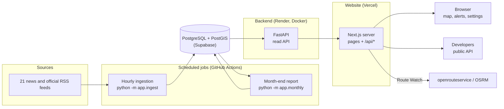
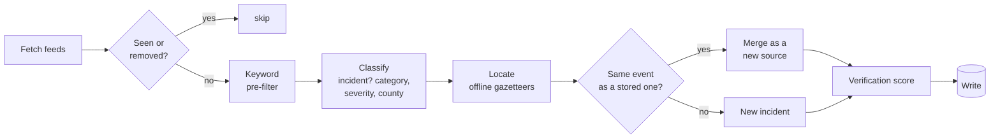

# Technical architecture

Deckwatch Kenya has three parts:
- a **Next.js website**, which also serves the public API;
- a **FastAPI backend** over **PostgreSQL/PostGIS**;
- **scheduled jobs**, which ingest news hourly and build the monthly report.

All of it is open source under the MIT licence. Every hosted service it runs on can be replaced by an open or self-hosted equivalent (§5).

## 1. System overview



- **Browsers never talk to the backend or the database.** The Next.js server proxies `/api/*` to the backend, using an address that is configured on the server only (`API_BASE_URL`).
- **Only the jobs write incidents.** The backend's public routes are read-only, apart from `POST /reports`, which stores nothing.
- **Visitor state stays in the browser.** Alert subscriptions and saved routes are kept in `localStorage`, and the alert matching runs on the device.

## 2. Ingestion pipeline



Each stage is a separate, unit-tested module in [`backend/app/ingest/`](../backend/app/ingest/):

| Module | Role |
|---|---|
| `sources.py` | The feed list; fetches and parses RSS |
| `prefilter.py` | Drops clearly irrelevant items before classification |
| `rules.py`, `classify.py`, `rag.py`, `hybrid.py` | Classifiers: rule-based (the default), LLM, retrieval-augmented, and rules with LLM fallback |
| `geocode.py` | Place-name gazetteer lookup, with a precision for each point |
| `dedup.py` | Same-place and same-story merging |
| `verification.py` | Corroboration score by owner group |
| `pipeline.py` | Wires the stages together |
| `evaluate.py`, `snapshot.py` | Accuracy measurement against hand labels |
| `merge_duplicates.py`, `relocate.py`, `repair.py` | One-off maintenance over stored data |

Collection, verification and storage are described in full in [data-governance.md](data-governance.md).

## 3. Repository layout

```
src/                     Next.js 16 app (React 19, Tailwind 4, Leaflet, Zustand)
  app/                   Routes: map, dashboard, counties, route-watch, reports, api-docs,
                         privacy, terms; app/api/* is the public API
  components/            UI components
  lib/                   Data access, the API spec, validation, stats, report logic
  store/                 Client state (persisted preferences, UI)
backend/                 FastAPI service (Python 3.9+, SQLAlchemy, GeoAlchemy2)
  app/routers/           Read API: incidents, counties, county summaries, monthly reports
  app/ingest/            Ingestion pipeline (above)
  app/monthly/           Monthly report consolidation and builder
  app/takedown.py        Removal on request
  fixtures/              Counties, gazetteers, RAG examples
  eval/                  Hand-labelled evaluation sample
  tests/                 pytest suite
.github/workflows/       CI, hourly ingestion (prod and dev), monthly report
docs/                    This documentation
scripts/                 Data-preparation scripts (gazetteer, county shapes, seed export)
```

## 4. Data model

| Table | Holds | Key fields |
|---|---|---|
| `incidents` | One row per real-world event | `id` (`ing-` plus a hash of the first article's link), `title`, `category`, `severity`, `county_name`, `location_name`, `geom` (PostGIS point), `location_precision`, `reported_at`, `verification_score`, `verification_status`, `sources` (JSONB: outlet name, type, link, headline, publish time), `ai_summary`, `recommended_actions` |
| `counties` | Kenya's 47 counties | `name`, `slug`, `code`, `center` |
| `monthly_reports` | One report per month | `month`, `generated_at`, `method` (editorial, claude or automatic), `data` (the whole report as JSONB) |
| `removed_articles` | Source links taken down on request | `url`, `incident_id`, `reason`, `removed_at` |

Tables are created by `python -m app.init_db`, which runs on every backend boot and before every ingestion run. It is idempotent.

## 5. Dependencies and replaceability

The full table, with licences and alternatives, is in the [README](../README.md#architecture-and-dependencies). In summary:

- **Open source, run anywhere:** Next.js, React, FastAPI, SQLAlchemy, PostgreSQL, PostGIS, Leaflet and fastembed.
- **Hosted services, all replaceable without code changes:**
  - Vercel, by any Node.js host;
  - Render, by any Docker host;
  - Supabase, by any PostGIS database;
  - GitHub Actions, by any scheduler;
  - openrouteservice, by a self-hosted OSRM.
- **Optional proprietary services:**
  - **Anthropic Claude.** The LLM classifier and written monthly summaries need it; the default rule classifier and the automatic report do not.
  - **Google Analytics.**

  Neither is needed to run Deckwatch.

## 6. Quality and testing

- **Frontend:** Vitest unit tests, TypeScript typecheck, ESLint and a production build on every push (`.github/workflows/ci.yml`).
- **Backend:** pytest. Database-free tests run in CI. Integration tests against a real PostGIS database run locally with `TEST_DATABASE_URL`.
- **Classifier accuracy:** `python -m app.ingest.evaluate` against [`backend/eval/labels.csv`](../backend/eval/labels.csv).

## 7. Related documents

- [API documentation](api.md)
- [Deployment](deployment.md)
- [Data governance](data-governance.md)
- [Privacy and safety](privacy-and-safety.md)
- [Governance principles](governance.md)
